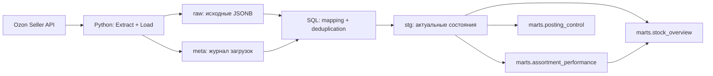
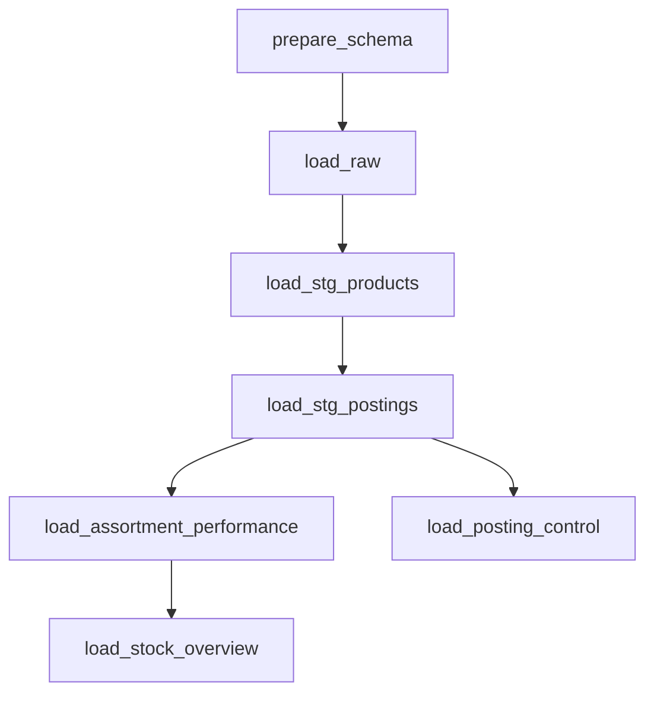

# Ozon DWH — хранилище данных двух действующих продавцов

**End-to-end ELT-пайплайн на Python, PostgreSQL, Apache Airflow и Docker Compose: от Ozon Seller API до трёх аналитических витрин.**

Проект работает с реальными каталогами и отправлениями двух независимых продавцов Ozon по схемам FBO и FBS. Он сохраняет исходные ответы API, формирует реляционный слой с актуальными состояниями товаров и отправлений и рассчитывает витрины для анализа ассортимента, остатков и обработки заказов.

Один и тот же код используется для обоих продавцов. Выбор продавца в параметрах Airflow определяет API-ключи и целевую базу данных: данные магазинов хранятся отдельно.

## Проект в цифрах

| Показатель | Результат |
|---|---|
| Реальные источники | 2 действующих продавца Ozon |
| Каталоги | Около 1,5 тыс. и 2,3 тыс. товаров |
| Отправления в хранилищах | Около 15 тыс. и 100 тыс. уникальных отправлений соответственно |
| Первичная загрузка отправлений | Запрос истории за последние 364 дня |
| Регулярное обновление | Повторная загрузка последних 56 дней |
| Модель данных на продавца | 4 схемы, 11 таблиц, включая 3 аналитические витрины |
| Оркестрация | 1 параметризованный DAG, 7 задач |

Объёмы округлены по контрольным запускам на реальных данных. Отправление — отдельная сущность: эти числа не обозначают количество заказов, товарных позиций или проданных единиц. В репозитории публикуется код; исходные данные продавцов не включаются.

## Для чего нужны витрины

Хранилище предоставляет аналитикам готовые SQL-таблицы с явно определённой детализацией и формулами показателей. Их можно подключить к BI-инструменту или использовать непосредственно в SQL:

- сравнить заказанные количества по SKU и схемам FBO/FBS за два последовательных периода;
- выделить товары с наибольшей долей стоимости доставленных позиций и оценить отмены;
- сопоставить текущие остатки и резерв с заказанными количествами за 28 дней;
- найти незавершённые отправления и FBS-отправления, ожидающие передачи в доставку после рекомендуемой даты отгрузки.

Результат проекта — обновляемый слой данных для аналитики. Расчёт показателей отделён от их визуализации.

## Технологии

| Технология | Применение |
|---|---|
| **Python 3** | Извлечение данных, пагинация, пакетные запросы, выбор продавца и периода, загрузка в БД |
| **Requests** | HTTP-запросы к REST API, таймауты, обработка HTTP-ошибок |
| **Psycopg 3** | PostgreSQL-соединения, параметризованный SQL, транзакции, `COPY FROM STDIN`, адаптация JSONB |
| **PostgreSQL 18** | Слои хранилища, JSONB, реляционная модель, трансформации и витрины |
| **SQL** | CTE, временные таблицы, `DISTINCT ON`, `ON CONFLICT`, `LATERAL`, `WITH ORDINALITY`, оконные и условные агрегаты |
| **Apache Airflow 3.3.2** | TaskFlow API, зависимости задач, параметры запуска, Connections и логи; `LocalExecutor` |
| **Docker Compose** | Развёртывание PostgreSQL и компонентов Airflow, сеть сервисов, постоянные volumes |

Для метаданных Airflow используется отдельный PostgreSQL 17. Базы продавцов размещены в PostgreSQL 18.

## Архитектура



Это **ELT**: Python извлекает данные и загружает их в `raw`, а преобразования выполняются SQL-скриптами внутри PostgreSQL. Полный JSON-объект товара или отправления сохраняется до преобразования, поэтому маппинг можно пересчитать без повторного обращения к API.

| Слой | Таблицы | Назначение |
|---|---|---|
| `raw` | `products`, `postings` | Накопление исходных JSONB-снимков с временем загрузки и идентификатором запуска |
| `stg` | `products`, `product_sources`, `product_stocks`, `postings`, `posting_items` | Типизированные актуальные состояния, раскрытые массивы и связи между сущностями |
| `marts` | `assortment_performance`, `stock_overview`, `posting_control` | Данные для анализа ассортимента, остатков и отправлений |
| `meta` | `load_runs` | Статусы загрузок в raw, количество полученных и записанных объектов, время и ошибки |

`stg` в этой архитектуре хранит последнее загруженное состояние каждой сущности. Исходные снимки остаются в `raw`; отдельного слоя SCD Type 2 нет.

## Ключевые инженерные решения

### Извлечение и массовая загрузка

- Каталог получается с пагинацией через `/v3/product/list`; детализация запрашивается пакетами до **1 000 product_id** через `/v3/product/info/list`.
- Отправления FBO и FBS загружаются через `/v3/posting/fbo/list` и `/v4/posting/fbs/list`. Курсорная пагинация учитывает `has_next` и останавливается с ошибкой при пустом или повторяющемся следующем курсоре.
- HTTP-запросы имеют таймаут и проверку статуса ответа. Доступность целевой БД проверяется до обращения к Ozon.
- Запись в PostgreSQL выполняется через **`COPY FROM STDIN`**, без отдельного `INSERT` на каждый объект.

### Повторные загрузки и актуализация состояний

Регулярный режим повторно запрашивает отправления за последние **56 дней**, чтобы получать изменения статусов в этом окне. Каталог перечитывается при каждом запуске. Это обновление через скользящее окно, а не CDC или получение только изменившихся записей.

В `raw` новые снимки добавляются к предыдущим. В `stg` выбирается последняя версия из успешных загрузок: по `loaded_at`, а при совпадении времени — по `raw_id`. Дедупликация выполняется через `DISTINCT ON` по бизнес-ключам:

- товар — `product_id`;
- отправление — `(scheme, posting_number)`.

Основные записи обновляются через **upsert** (`INSERT … ON CONFLICT DO UPDATE`). Вложенные коллекции заменяются для соответствующих сущностей в одной транзакции. Повторное преобразование одного набора raw-данных не накапливает дубликаты в `stg`.

### Реляционная модель и работа с JSONB

Массивы SKU-источников, остатков и товарных позиций раскрываются через `jsonb_array_elements`, `CROSS JOIN LATERAL` и `WITH ORDINALITY`. Разные коллекции обрабатываются отдельно, чтобы избежать перемножения строк.

Товарные позиции отправлений связываются с каталогом через SKU. Если SKU соответствует нескольким `product_id`, связь остаётся `NULL`: код не выбирает произвольный товар и не размножает позиции при соединении.

### Транзакции и прослеживаемость

- Для загрузки каталога и загрузки отправлений формируются отдельные UUID `load_run_id`.
- `meta.load_runs` фиксирует состояния `running`, `success`, `failed`, счётчики и ошибки записи в raw.
- Запись набора в raw и перевод соответствующего запуска в `success` фиксируются **одной транзакцией**. При ошибке записи набор откатывается, после чего отдельно сохраняется статус `failed`.
- Строки `stg` содержат `source_raw_id`, `source_loaded_at` и `load_run_id`: можно найти исходный payload и загрузку, из которой получена запись — **data lineage** на уровне строки.
- SQL-скрипты используют `BEGIN` / `COMMIT` и блокировки целевых таблиц. Каждый этап имеет свою транзакцию; DAG целиком не является одной транзакцией.

Ошибки извлечения до начала записи в raw видны в логах Airflow. `meta.load_runs` описывает этап загрузки в БД, а не весь жизненный цикл DAG.

## Аналитические витрины

| Витрина | Одна строка | Основные показатели |
|---|---|---|
| `marts.assortment_performance` | Период × схема FBO/FBS × SKU × валюта | Заказанные, доставленные и отменённые единицы; стоимость доставленных позиций; динамика к предыдущему периоду; доли |
| `marts.stock_overview` | Товар × SKU × схема FBO/FBS | Остаток, резерв, заказанные единицы за 28 дней, среднее заказанное количество в день |
| `marts.posting_control` | Схема FBO/FBS × номер отправления | Статус, состав отправления, время незавершённой обработки, длительность до передачи в доставку для FBS, признак ожидания после даты отгрузки |

Для показателей ассортимента используются последние **28 полных календарных дней по Москве** и предшествующие им 28 дней. Период определяется по началу обработки отправления, статус берётся из последнего загруженного состояния. Границы фильтрации задаются полуоткрытым интервалом: `>= начало` и `< следующий день после конца`.

Денежные показатели группируются по валюте и сохраняются с точностью до трёх знаков после запятой. Деление на ноль защищено через `NULLIF`: например, при нулевой базе сравнения процент изменения остаётся `NULL`.

`delivered_gross_amount` — сумма `quantity × unit_price` для позиций доставленных отправлений. Это стоимость позиций до учёта комиссий, логистики и возвратов, а не чистая прибыль или фактическая выплата продавцу. Доля отмен рассчитывается по единицам в статусах `delivered` и `cancelled`.

## Оркестрация в Airflow



Зависимости отражают порядок подготовки данных: сначала каталог, затем отправления и их связь с товарами, после — витрины. `stock_overview` использует уже рассчитанные показатели `assortment_performance`.

| Параметр | Поведение |
|---|---|
| `seller` | `seller_1` или `seller_2`: выбор ключей и подключения к базе |
| `initialize` | При `true` проверяет наличие структуры, создаёт её в пустой базе и выбирает загрузку за 364 дня |
| `mode=regular` | Отправления за последние 56 дней |
| `mode=year` | Отправления за последние 364 дня |
| `mode=custom` | Период из `since` и `to` в ISO 8601 с часовым поясом |

Для произвольного периода проверяются порядок дат, отсутствие будущих дат и допустимая глубина истории. При частично созданной структуре инициализация останавливается с ошибкой; существующая полная структура сохраняется.

В текущей конфигурации DAG запускается вручную, `schedule=None`, `catchup=False`, `max_active_runs=1`. Airflow управляет выполнением задач и предоставляет статусы и логи каждого этапа.

## Два продавца — один пайплайн

Используется подход **database-per-seller**: общая реализация и отдельная база каждого продавца в одном PostgreSQL-сервисе.

| Продавец | Airflow Connection ID | База данных |
|---|---|---|
| `seller_1` | `ozon_dwh` | `ozon_dwh` |
| `seller_2` | `ozon_dwh_seller2` | `ozon_dwh_seller2` |

Переключение продавца не требует очистки хранилища или изменения SQL. Второй продавец с объёмом около **100 тыс. отправлений** использует тот же DAG и те же трансформации. Это проверка повторного применения решения на другом реальном наборе данных.

## Структура кода

```text
ozon_dwh/
├── main.py                         # Параметры запуска, продавцы, периоды и вызовы загрузки
├── ozon_functions.py               # Ozon API, пагинация, COPY и журнал загрузок
├── compose.yaml                    # PostgreSQL и компоненты Airflow
├── dags/
│   └── ozon_dwh_pipeline.py         # Основной DAG из 7 задач
└── sql/
    ├── 01_create_objects.sql       # Схемы, таблицы, ограничения и комментарии
    ├── 02_load_products.sql        # raw → stg: каталог, SKU-источники, остатки
    ├── 03_load_postings.sql        # raw → stg: отправления и позиции
    ├── 04_load_assortment_performance.sql
    ├── 05_load_stock_overview.sql
    └── 06_load_posting_control.sql
```

Python-код загрузки отделён от точки входа; DDL отделён от SQL-трансформаций. Основная бизнес-логика расчёта витрин находится в SQL и доступна для отдельного просмотра и запуска.

## Запуск

Для работы нужны Docker с Compose и собственные доступы к Ozon Seller API. Локальный `.env` содержит `POSTGRES_PASSWORD`, `AIRFLOW_DB_PASSWORD`, `AIRFLOW_FERNET_KEY`, `AIRFLOW_JWT_SECRET`, `OZON_CLIENT_ID` и `OZON_API_KEY`. Для второго продавца добавляются `OZON_CLIENT_ID_2` и `OZON_API_KEY_2`. Fernet key должен быть корректным ключом Fernet; пароль метабазы Airflow входит в URI подключения, поэтому специальные символы требуют корректного URL-кодирования.

```bash
docker compose up -d
docker compose ps
```

После запуска:

1. Открыть Airflow на `http://localhost:8080` и войти с учётными данными своего развёртывания.
2. Создать PostgreSQL Connection `ozon_dwh`: host `postgres`, port `5432`, database `ozon_dwh`, login `ozon_user`, password — заданный при создании PostgreSQL.
3. Для второго продавца предварительно создать отдельную базу `ozon_dwh_seller2` и аналогичный Connection с ID `ozon_dwh_seller2`. Compose автоматически создаёт только первую базу; `prepare_schema` создаёт таблицы внутри выбранной существующей базы.
4. Запустить `ozon_dwh_pipeline`, выбрать продавца и включить `initialize` для первичной загрузки.
5. Для следующих обновлений выключить `initialize` и выбрать `regular`, `year` или `custom`.

Из DBeaver на компьютере PostgreSQL доступен по `localhost:5433`. Контейнеры Airflow обращаются к нему внутри Docker-сети по `postgres:5432`. Данные PostgreSQL сохраняются в именованном volume.

API-ключи передаются через переменные окружения; подключения к хранилищам — через Airflow Connections. Секреты и реальные выгрузки не предназначены для публикации.

## Проверка на реальных данных и границы реализации

Полный цикл загрузки и расчёта витрин выполнен для обоих продавцов. Для первого продавца также проверен повторный запуск обновления. Контроль включал успешность задач Airflow, соответствие актуальных записей `stg` исходным снимкам, отсутствие дублей по ключам детализации и раздельное хранение данных продавцов.

Эти проверки подтверждают работоспособность цепочки; отдельного автоматизированного data quality framework пока нет. API-ответы накапливаются в памяти перед загрузкой, автоматические retries HTTP-запросов не настроены. Обновление за 56 дней актуализирует состояния только внутри выбранного окна; для более старых отправлений предусмотрены режимы `year` и `custom`.

Расчётные окна витрин привязаны к дате их запуска. `custom` меняет период извлечения отправлений, но не период аналитических витрин. Исторические показатели используют последнее доступное состояние отправлений; для интерпретации результатов важны полнота загруженного периода и время последнего обновления.
